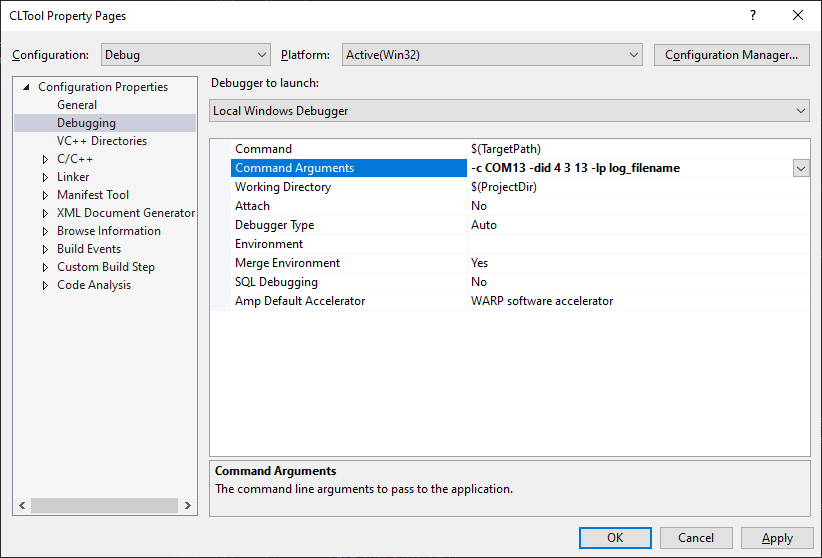

# CLTool

## Overview
The Inertial Sense CLTool is a command line utility that can be used to read and display data, update firmware, and log data from Inertial Sense products. Additionally, CLTool serves as example source code that demonstrates integration of the Inertial Sense SDK into your own source code. The CLTool can be compiled in Linux, Mac, Windows and embedded platforms.

## Help Menu

```bash
# Command line utility for communicating, logging, and updating firmware with Inertial Sense product line.

EXAMPLES
    cltool -c /dev/ttyS2 -did DID_INS_1 DID_GNSS1_POS DID_PIMU      # stream DID messages
    cltool -c /dev/ttyS2 -did 4 13 3                # stream same as line above
    cltool -c /dev/ttyS2 -did 3=5                   # stream DID_PIMU at startupNavDtMs x 5
    cltool -c /dev/ttyS2 -presetPPD                 # stream post processing data (PPD) with INS2
    cltool -c /dev/ttyS2 -presetPPD -lon -lts=1     # stream PPD + INS2 data, logging, dir timestamp
    cltool -c /dev/ttyS2 -edit DID_FLASH_CONFIG     # edit DID_FLASH_CONFIG message
    cltool -c /dev/ttyS2 -baud=115200 -did 5 13=10  # stream at 115200 bps, GPS streamed at 10x startupGnssDtMs
    cltool -c * -baud=921600                        # 921600 bps baudrate on all serial ports
    cltool -rp logs/20170117_222549                 # replay log files from a folder
    cltool -c /dev/ttyS2 -rover=RTCM3:192.168.1.100:7777:mount:user:password         # Connect to RTK NTRIP base
    cltool -c /dev/ttyS2 -get 1,4,13,DID_GNSS1_POS                                    # Return specific DIDs
    cltool -c /dev/ttyS2 -get "{DID_INS_1: {insStatus, theta}, DID_INS_2: {qn2b}}"   # Return portion of two DIDs
    cltool -c /dev/ttyS2 -set "{DID_FLASH_CONFIG: {gnss1AntOffset[1]: 0.8}}"          # Set one value in DID array
    cltool -c /dev/ttyS2 -set "{DID_FLASH_CONFIG: {gnss1AntOffset: [0.8, 0.0, 1.2]}}" # Set values in DID
    cltool -c /dev/ttyS2 -nmea=ASCE,0,GxGGA,1                                         # Send NMEA message, display rx NMEA
    cltool -c tcp://192.168.1.100:7777 -nmea=ASCE                                     # Send NMEA query over TCP
    cltool -c COM2,COM4 -nmea                                                         # Listen for NMEA on two ports
    cltool -c /dev/ttyS2 -cbor-get "{FLASH_CFG: {ser0BaudRate, insRotation}}"        # Read fields over CBOR
    cltool -c /dev/ttyS2 -cbor-set "{FLASH_CFG: {gnss1AntOffset[1]: 0.8}}"            # Set one value over CBOR

EXAMPLES (Firmware Update)
    cltool -c /dev/ttyS2 -ufpkg fw/IS-firmware.fpkg
    cltool -c /dev/ttyS2 -uf fw/IS_IMX-5.hex -ub fw/IS_bootloader-STM32L4.hex -uv

OPTIONS (General)
    -baud=BAUDRATE  Set serial port baudrate.  Options: 115200, 230400, 460800, 921600 (default)
    -c DEVICE_PORT  Select port(s): serial port (e.g., /dev/ttyUSB0 or COM5), tcp://IP:port, or a comma-separated list of these.
                    Set DEVICE_PORT to "*" for all ports or "*4" for only first four.
    -dboc           Send stop-broadcast command `$STPB` on close.
    -h --help       Display this help menu.
    -list-devices   Discovers and prints a list of discovered Inertial Sense devices and connected ports.
    -lm             Listen mode for ISB. Disables device verification (-vd) and does not send stop-broadcast command on start.
    -magRecal[n]    Recalibrate magnetometers: 0=multi-axis, 1=single-axis
    -nmea=[s]       Send stop-broadcast command `$STPC`, then NMEA message s with added checksum footer. Display rx NMEA. (`-nmea=ASCE,0,GxGGA,1`) With s empty (`-nmea=`), only sends `$STPC`.
    -nmea           Listen mode for NMEA. Displays rx NMEA and sends nothing to the device (like -lm).
                    Only rx NMEA with a valid checksum is displayed, timestamped. Works with any -c port type. Runs until 'q' or -dur.
    -q              Quiet mode, no display.
    -raw-out        Outputs all data in a human-readable raw format (used for debugging/learning the ISB protocol).
    -reset          Issue software reset.
    -s              Scroll displayed messages to show history.
    -stats          Display statistics of data received.
    -survey=[s],[d] Survey-in and store base position to refLla: s=[2=3D, 3=float, 4=fix], d=durationSec
    -sysCmd=[c]     Send DID_SYS_CMD c (see eSystemCommand) command then exit the program.
    -vd             Disable device validation.  Use to keep port(s) open even if device response is not received.
    -verbose[=n]    Enable verbose event logging. Use optional '=n' to specify log level between 0 (errors only) and 99 (all events)
    -v              Print version information.

OPTIONS (Special)
    -factoryReset   Reset IMX flash config to factory defaults.
    -romBootloader  Reboot into ROM bootloader mode.  Requires power cycle and reloading bootloader and firmware.

OPTIONS (Event)
    -evf=[t],[po],[pr],[id]    Sets which DID_EVENT's can be broadcast for debug purposes.
         target:        t=[0=device, 1=device's GNSS1 port, 2=device's GNSS2 port],
         portMask:      po=[0x80=currentPort, 0x08=USB port, 0x04=UART2, 0x02=UART1, 0x01=UART)],
         priorityLevel: pr=[Priority ID's to be enabled. See:eEventPriority for protocol EV_ID values].
             It is recommended to have a minimum level of 1 at all times to allow broadcast of critical errors.
         msgTypeIdMask: id=[Protocol ID's to be enabled. Mask together protocol EV_ID value (0x01 << EV_ID).
             See:eEventProtocol for protocol EV_ID values]. It is recommended to mask (0x01 << EVENT_MSG_TYPE_ID_ASCII)
             at all times to allow broadcast of critical errors.

OPTIONS (Firmware Update)
    -ufpkg FILEPATH Update firmware using firmware package file (.fpkg) at FILEPATH.
    -uf FILEPATH    Update app firmware using .hex file FILEPATH.  Add -baud=115200 for systems w/ baud limits.
    -ub FILEPATH    Update bootloader using .bin file FILEPATH if version is old. Must be used with option -uf.
    -fb             Force bootloader update regardless of the version.
    -uv             Run verification after application firmware update.

OPTIONS (Messages)
    -get <DID1>,<DID2>,...                   Return values of dataset(s). DID may be a name or number.
    -get "{<DID>: {<FIELD1>,<FIELD2>,...}}"  Return values of dataset(s). DID may be a name or number. YAML input format.
                                             Examples: -get 1,4,12,DID_GNSS1_POS
                                                       -get "{DID_INS_1,DID_GNSS1_POS}"
                                                       -get "{DID_INS_1: {insStatus, theta}, DID_INS_2: {qn2b}}"
    -set "{<DID>: {<FIELD1>: <VALUE>, ...}}" Set values of dataset(s). DID may be a number or name. YAML input format.
                                             Examples: -set "{DID_FLASH_CONFIG: {gnss1AntOffset: [0.8, 0.0, 1.2]}}"
                                                       -set "{DID_FLASH_CONFIG: {gnss1AntOffset[2]: 1.2}}"
                                                       -set "{12: {ioConfig: 0x1a2b012c, ser2BaudRate: 921600}}"
    -cbor-get "{<DID>: {<FIELD1>,<FIELD2>,...}}" As -get, over CBOR (DID_CBOR). DID: registry name (FLASH_CFG), DID_ name or number.
                                             Examples: -cbor-get FLASH_CFG
                                                       -cbor-get "{GPX_FLASH_CFG: {ser2BaudRate}}" -cbor-dst=GPX
    -cbor-set "{<DID>: {<FIELD1>: <VALUE>, ...}}" As -set, over CBOR. Numeric keys (incl. MSG_* keys) are sent as given.
                                             Examples: -cbor-set "{FLASH_CFG: {gnss1AntOffset[2]: 1.2}}"
                                                       -cbor-set "{RMC_STORED: {0: {RMC_PRESET: INS}}}"
    -cbor-dst=<FILTER>    Device(s) a -cbor-get/-cbor-set addresses: TYPE[-MAJOR[.MINOR]][::SN], parts left out match any
                          (GPX, GPX-1.0, IMX-5.0::SN62797), or all.
                          Without it, the device at the other end of the link answers. A wildcard collects every reply.
    -cbor-ack=<LEVEL>     Reply level of a -cbor-set: none, minimal (default: errors and adjusted values) or detailed.
    -cbor-timeout=<MS>    Time allowed for each CBOR reply (default 1000).
    -cbor-out[=raw]       Print every DID_CBOR message sent and received, in CBOR diagnostic notation with
                          registry names (=raw: plain diagnostic notation).
    -did [DID#<=PERIODMULT> DID#<=PERIODMULT> ...]  Stream 1 or more datasets and display w/ compact view.
    -edit [DID#<=PERIODMULT>]                       Stream and edit 1 dataset.
          Each DID# can be the DID number or name and appended with <=PERIODMULT> to decrease message frequency. 
          Message period = source period x PERIODMULT. PERIODMULT is 1 if not specified.
          Common DIDs: DID_INS_1, DID_INS_2, DID_INS_4, DID_PIMU, DID_IMU, DID_GNSS1_POS,
          DID_GNSS2_RTK_CMP_REL, DID_BAROMETER, DID_MAGNETOMETER, DID_FLASH_CONFIG (see data_sets.h for complete list)
    -dids           Print list of all DID datasets
    -persistent     Save current streams as persistent messages enabled on startup
    -presetPPD      Send RMC preset to enable IMX post processing data (PPD) stream
    -presetINS      Send RMC preset to enable INS data stream
    -presetGPXPPD   Send RMC preset to enable GPX post processing data (PPD) stream

OPTIONS (Logging to file, disabled by default)
    -lon            Enable logging
    -lt=TYPE        Log type: raw (default), dat, sdat, kml or csv
    -lp PATH        Log data to path (default: ./IS_logs)
    -lmb=MB         File culling: Log drive usage limit in MB. (default: 0). `-lmb=0 -lms=0` disables file culling.
    -lms=PERCENT    File culling: Log drive space limit in percent of total drive, 0.0 to 1.0. (default: 0.5)
    -lmf=BYTES      Log max file size in bytes (default: 5242880)
    -lts=0          Log sub folder, 0 or blank for none, 1 for timestamp, else use as is
    -r              Replay data log from default path
    -rp PATH        Replay data log from PATH
    -rs=SPEED       Replay data log at x SPEED. SPEED=0 runs as fast as possible.

OPTIONS (READ flash config) - DEPRECATED, use `-get` instead
    -imxFlashCfg                                # List all "keys" and "values" in IMX
    -gpxFlashCfg                                # List all "keys" and "values" in GPX
    "-imxFlashCfg=[key]|[key]|[key]"            # List specific IMX values
    "-gpxFlashCfg=[key]|[key]|[key]"            # List specific GPX values

OPTIONS (WRITE flash config) - DEPRECATED, use `-set` instead
    "-imxFlashCfg=[key]=[value]|[key]=[value]"  # Set key / value pairs in IMX flash config. 
    "-gpxFlashCfg=[key]=[value]|[key]=[value]"  # Set key / value pairs in GPX flash config. 
                                                # Surround with "quotes" when using pipe operator.
EXAMPLES
    cltool -c /dev/ttyS2 -imxFlashCfg  # Read from device and print all keys and values
    cltool -c /dev/ttyS2 "-imxFlashCfg=insOffset[1]=1.2|ser2BaudRate=115200"  # Set multiple values

OPTIONS (RTK Rover / Base)
    -rover=[type]:[IP or URL]:[port]:[mountpoint]:[username]:[password]
        As a rover (client), receive RTK corrections.  Examples:
            -rover=TCP:RTCM3:192.168.1.100:7777:mountpoint:username:password   (NTRIP)
            -rover=TCP:RTCM3:192.168.1.100:7777
            -rover=TCP:UBLOX:192.168.1.100:7777
            -rover=SERIAL:RTCM3:/dev/ttyS2:57600        (port, baud rate)
    -base=[IP]:[port]   As a Base (sever), send RTK corrections.  Examples:
            -base=TCP::7777                             (IP is optional)
            -base=TCP:192.168.1.43:7777
            -base=SERIAL:/dev/ttyS2:921600
```

## Compile & Run (Linux/Mac)

1. You must have cmake installed on your machine. To do this, download the cmake application at https://cmake.org/download/. Then, using the command line, you will need to install cmake with either of the following commands depending on your platform:
    ```bash
    Mac:
    sudo "/Applications/CMake.app/Contents.bin/cmake-gui" --install
    
    Linux:
    sudo apt-get install cmake
    ```
2. Create build directory
   ```bash
   cd cltool
   mkdir build
   ```

3. Run cmake from within build directory
   ```bash
   cd build
   cmake ..
   ```

4. Compile using make
   ```bash
   make
   ```

5. If necessary, add current user to the "dialout" group in order to read and write to the USB serial communication ports:
   ```bash
   sudo usermod -a -G dialout $USER
   sudo usermod -a -G plugdev $USER
   (reboot computer)
   ```

6. Run executable
   ``` bash
   cd build
   ./cltool
   ```

## Compile & Run (Windows CMake CL)
1. Install CMake for Windows

2. Create build directory
    ```bash
    cd cltool
    mkdir build
    
3. Run cmake from within build directory
   ```bash
   cd build
   cmake ..
   ```

4. Compile
   ```bash
   cmake --build .
   ```
5. Run executable
   ``` bash
   cd Release (or Debug depending on CMake configuration you selected)
   cltool.exe
   ```
## Compile & Run (Windows CMake Visual Studio)
Windows Visual Studio supports CMake projects. Follow the instructions provided by Microsoft:
https://learn.microsoft.com/en-us/cpp/build/cmake-projects-in-visual-studio?view=msvc-170

## Updating Firmware with CLTool
### Updating using Firmware Package

Updating firmware using a firmware package file provides a simple method to update multiple devices in one process.  This include the ability to update an IMX-GPX module pair in one step.  The cltool only needs know the file path of the firmware package file and the serial port of the device to be updated.  The file extension for a firmware package is `.fpkg`.

**NOTE:** Updating the IMX firmware using a firmware package currently not supported and will become available in a future update.

```bash
cltool -c DEVICE_PORT -ufpkg FILEPATH
```

The following is a specific example of using a firmware package file:

```bash
cltool -c /dev/ttyACM0 -ufpkg IS-firmware_2.0.3_2024-03-18_213925.fpkg
```

### Updating using Single Firmware File (Legacy Mode)

The CLTool can be used to update device firmware with the following options.  This is the legacy firmware update methods that works only with the IMX-5 and earlier products (IMX-3, EVB-2, etc.).

```bash
cltool -c DEVICE_PORT -uf [FW_FILEPATH] -ub [BL_FILEPATH] -uv
```

| Options             | Description                                                  |
| ------------------- | ------------------------------------------------------------ |
| `-c DEVICE_PORT`    | Specifies the device serial or USB port (i.e. `/dev/ttyACM0`). |
| `-uf [FW_FILEPATH]` | Specifies the application firmware file path.                |
| `-ub [BL_FILEPATH]` | (Optional) Specified the bootloader firmware file.  The bootloader is only updated if the version of the file provided is newer than the bootloader version currently on the device. |
| `-uv`               | (Optional) Run verification after application firmware update. |

The following is a specific example:

```bash
cltool -c /dev/ttyS2 -uf fw/IS_IMX-5.hex -ub fw/IS_bootloader-STM32L4.hex -uv	
```

Note: The firmware can only be updated at the following baud rates: 3000000, 921600, 460800, 230400, 115200

## CBOR Messaging

On firmware that supports CBOR messaging (`DID_CBOR`), `-cbor-get` and `-cbor-set` read and write configuration in the same YAML form as `-get` and `-set`. DIDs and fields use the CBOR registry names (`FLASH_CFG`, `GPX_FLASH_CFG`, `CAN_CONFIG`, `RMC_STORED`); the legacy `DID_` names and numbers are also accepted. Replies are printed as YAML.

The DIDs and fields available are listed in [CBOR Parameters](../com-protocol/cbor-parameters.md), and the messages themselves are described in [CBOR Messaging](../com-protocol/cbor.md).

```bash
$ cltool -c /dev/ttyACM0 -cbor-get "{FLASH_CFG: {ser0BaudRate, insRotation, gnssMinimumElevation}}"
FLASH_CFG:
  ser0BaudRate: 921600
  insRotation:
    - 0
    - 0
    - 0
  gnssMinimumElevation: 0.17453292
```

A GPX connected through an IMX is read by addressing it with `-cbor-dst`. Any part of the filter left out matches every value, so `GPX`, `GPX-1.0` and `GPX-1.0::SN928401213` all reach the same single GPX. A filter that can match more than one device collects a reply from each:

```bash
$ cltool -c /dev/ttyACM0 -cbor-get "{GPX_FLASH_CFG: {ser2BaudRate, startupGnssDtMs}}" -cbor-dst=GPX
GPX-1.0::928401213:
  GPX_FLASH_CFG:
    ser2BaudRate: 921600
    startupGnssDtMs: 200

$ cltool -c /dev/ttyACM0 -cbor-get "{CAN_CONFIG: {can_setting}}" -cbor-dst=all
IMX-5.0::62797:
  CAN_CONFIG:
    can_setting: 100
GPX-1.0::928401213: OK
```

A write prints `OK`, or the values the device adjusted. With `-cbor-ack=detailed` it prints every value as the device kept it. A write the device refuses prints its status and exits with a non-zero code:

```bash
$ cltool -c /dev/ttyACM0 -cbor-set "{FLASH_CFG: {gnss2AntOffset[2]: 0.5}}"
OK

$ cltool -c /dev/ttyACM0 -cbor-set "{ROUTE_FILTER: {0: {ACTION: ALLOW}}}"
ROUTE_FILTER:
  MSG_STATUS: READ_ONLY
```

`-cbor-out` prints every CBOR message sent and received, in CBOR diagnostic notation with registry names (`-cbor-out=raw` for plain diagnostic notation):

```bash
$ cltool -c /dev/ttyACM0 -cbor-out -cbor-get "{FLASH_CFG: {ser0BaudRate}}"
CBOR tx: {MSG_TYPE(0xC000): GET, MSG_REQ_ID(0xC003): 1, FLASH_CFG(12): [2]}
CBOR rx: {MSG_TYPE(0xC000): REPLY|GET, MSG_SRC_DEV_ID(0xC001): IMX-5.0::62797, MSG_REQ_ID(0xC003): 1, MSG_TIME_GPS_NS(0xC006): week 2441 tow 507663.403376, FLASH_CFG(12): {ser0BaudRate(2): 921600}}
FLASH_CFG:
  ser0BaudRate: 921600
```

`-imxFlashCfg` and `-gpxFlashCfg` use CBOR when the device supports it, and the binary DIDs otherwise; their usage is unchanged. `-gpxFlashCfg` still changes the configuration of a GPX connected through an IMX, but the change is proxied by the IMX rather than forwarded: the IMX applies it to its own copy of the GPX's configuration and then sends it on to the GPX.

Some GPX settings are set by the IMX's own flash configuration: `startupGnssDtMs`, `gnss1AntOffset`, `gnss2AntOffset`, `refLla`, `gnssSatSigConst`, `dynamicModel`, `gnssTimeSyncPeriodMs`, `gnssTimeUserDelay`, `gnssMinimumElevation`, `RTKCfgBits`, `gnssCn0Minimum` and `gnssCn0DynMinOffset`. For a GPX behind an IMX, change these with `-flashCfg` on the IMX. A `-gpxFlashCfg` write keeps the IMX's values for them, applies the other fields, and lists the values the IMX kept. After a write, `-gpxFlashCfg` reads the written fields back from the GPX and prints them:

```bash
$ cltool -c /dev/ttyACM0 "-gpxFlashCfg=gnss1AntOffset[0]=0.7|ser2BaudRate=460800"
The IMX kept the values its flash config sets:
GPX_FLASH_CFG:
  gnss1AntOffset:
    - 0.2
    - 0
    - 0
DID_GPX_FLASH_CFG (121)
gnss1AntOffset[0] = 0.2
gnss1AntOffset[1] = 0
gnss1AntOffset[2] = 0
ser2BaudRate = 460800
```

A write the device refuses, or one the GPX does not apply within 3 seconds, prints the reason or the values the GPX kept, and exits with -2.

## Logging with CLTool

The CLTool can be used to log data to file with the following options: 

```	bash
cltool -c DEVICE_PORT -lon -lt=LOG_TYPE -lp DIRECTORY
```

| Options         | Description                                                  |
| --------------- | ------------------------------------------------------------ |
| `-lon`          | Enable logging.                                              |
| `-lt=LOG_TYPE`  | Specifies the  [log file type](#log-type) to be written.  LOG_TYPE can be `raw`, `dat`, or `csv`. |
| `-lp DIRECTORY` | (Optional) Specifies the path where log files will be written.  When not specified, the default location will be the current working directory. |

### Log File Types

### Log Type

| Log Type | Description                                                  |
| -------- | ------------------------------------------------------------ |
| `raw`    | Binary file containing byte for byte data received over the serial ports.  All packets remain in their native form.  Used for logging InertialSense binary (ISB), NMEA, RTCM3, uBlox UBX binary and SPARTN, and any other packet formats.  ***Recommended for logging all data formats and post processing***. |
| `dat`    | Binary file containing InertialSense binary (ISB) DID data sets in "chunk" groups containing data in serial order as they appear over the serial port.  Default file format.  ***Recommended for post processing.*** |
| `csv`    | Comma-Separated Values - Plain text file that uses specific structuring to arrange tabular data. Its basic format involves separating each data field (or cell in a table) with a comma and each record (or row) is on a new line. This simple format allows for ease in data import and export between programs that handle tabular data, such as databases and spreadsheets. |

The following is an example of enabling the logger with type raw and specifying the output directory:
```bash
./cltool -c /dev/ttyACM0 -lon -lt=raw -lp /media/usbdrive/data
```

## Command Line Options

Navigate to the directory `/cpp/SDK/cltool/build` and run the CLTool with the help option, "`-h`"

``` bash
./cltool -h
```

to display the command line options

## Command Line Options in MS Visual Studio
When using MS Visual Studio IDE, command line arguments can be supplied by right clicking the project in the solution explorer and then selecting **Configuration Properties -> Debugging -> Command Arguments** (see image below).


